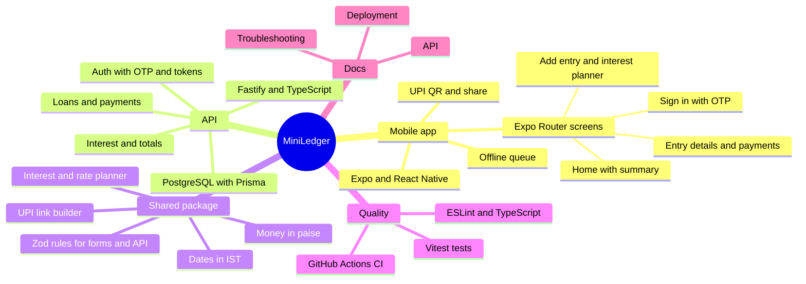

<div align="center">

# MiniLedger

**A simple, offline-friendly Android app to track money you've lent to friends.**
Part payments, optional interest, and a UPI QR to ask for your money back.

Created by **CodeCraftman2** · Version 0.1.0 · All rights reserved

</div>

---

## About

Lending money to friends is easy. Remembering who owes you what, how much of it has come back, and when it was due is not. MiniLedger keeps that list for you.

You add an entry (friend, amount, due date), record payments as they arrive, and the app shows what is still owed, what is overdue, and, if you charge interest, how much interest has built up. When it's time to ask for the money, it shows a UPI QR with the exact amount filled in.

It is built as an Android-first React Native app with its own API, all in one repository.

| | |
|---|---|
| Live API | _add your Render URL here_ (`/docs` for Swagger, `/health` for uptime) |
| Android APK | _add your release link here_ |

> **Cold starts:** on Render's free tier the API sleeps after about 15 minutes without traffic. The first request after that can take 30–60 seconds.

## Features

**Tracking**
- Sign in with your mobile number and a 6-digit OTP.
- Add an entry with a friend's name, an amount in rupees, and a due date.
- A home screen with what is **to receive**, what you've **received**, and what is **overdue**.
- Filters for All, Overdue and Repaid, with overdue flagged in red.

**Money coming back**
- **Part payments.** Lent ₹1,000 and got ₹100 back? Record it; the entry shows ₹900 still owed, with a full payment history.
- **Received in full** in one tap. The entry closes itself when nothing is left.
- You can't record more than is owed, and two payments at the same moment can't overpay a loan.

**Interest (optional, per entry)**
- Simple interest on what is still owed, per month or per year.
- Payments clear interest first, then the amount you lent.
- **Rate planner:** type the rate and see what you'll earn by the due date, or type the interest you *want* to earn and get the rate to charge.

**Asking for payment**
- **UPI QR** for the exact amount owed today (interest included). Your friend scans it with any UPI app.
- A ready-to-send message with your UPI ID. Your UPI ID stays on your phone only, kept separately for each account.
- Edit it, or remove it and add a new one, any time.

**Everyday polish**
- Works offline: saved entries open without a connection, and anything you add or record while offline is sent when you're back online, without ever duplicating.
- iOS-style design with soft cards, a segmented filter, and bottom sheets you can drag taller or shorter.
- Keypad-aware screens, so fields are never hidden.

## How it's put together



```
apps/api         Fastify 5 + TypeScript + Prisma + PostgreSQL
apps/mobile      Expo (React Native) + Expo Router + TanStack Query
packages/shared  Zod schemas and money, date and interest helpers used by BOTH of the above
docs/            API.md, DEPLOYMENT.md, TROUBLESHOOTING.md
```

The shared package is the point of the layout: the same rules that validate a loan in the API validate the form in the app, and the same interest maths runs on both, so the two can never disagree about what is owed.

## License

**Copyright © 2026 CodeCraftman2. All rights reserved.**

This is proprietary software. It is **not** open source.

- You may **not** copy, share, redistribute, publish, sell, or host this code or app, in whole or in part.
- You may **not** modify it, make derivative works from it, or reuse any part of it in another project.
- Looking at the code is allowed. Nothing else is, unless you have the author's **prior written permission**.
- If permission is given, you must **credit the author** — *"MiniLedger by CodeCraftman2"* — clearly, wherever the work is used, shown or distributed, and keep the copyright notice in place.

The software is provided "as is", without warranty of any kind. See the [LICENSE](LICENSE) file for the full terms.
